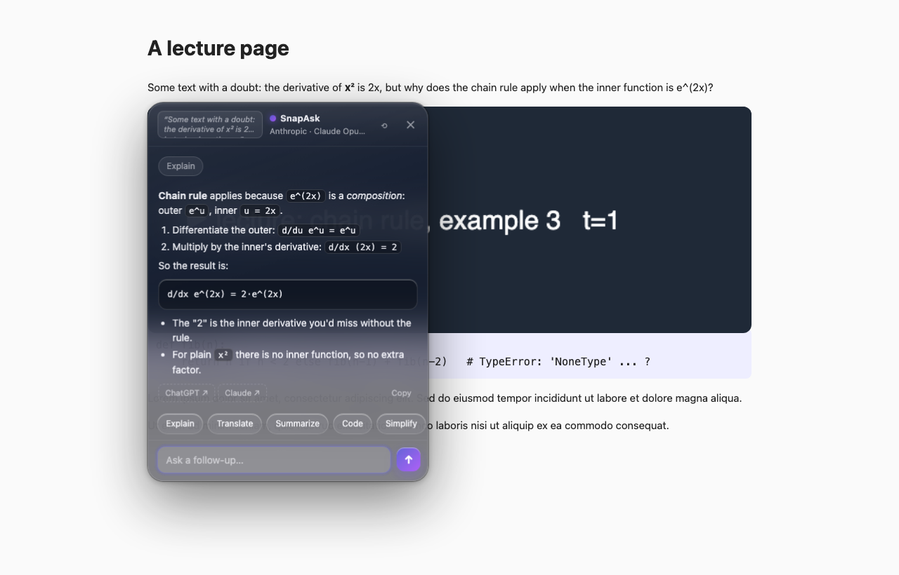
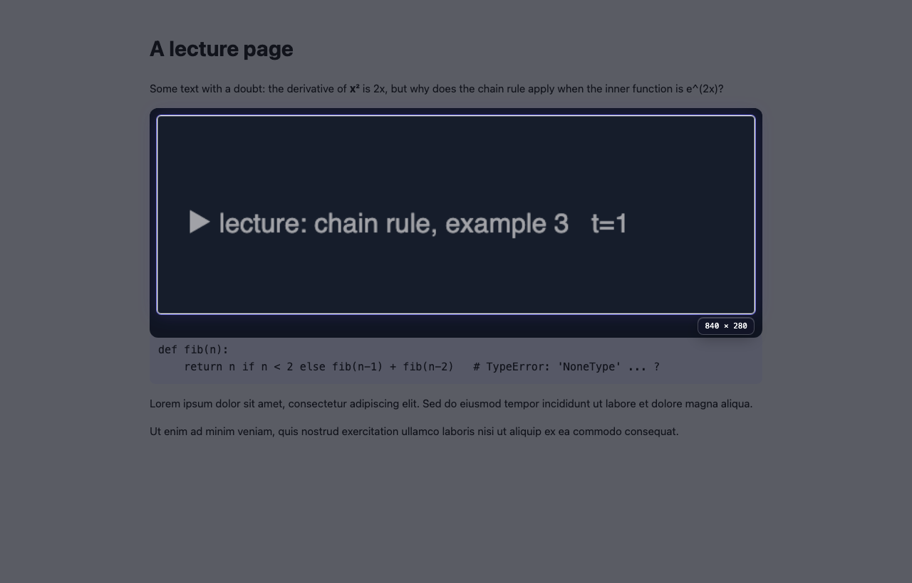
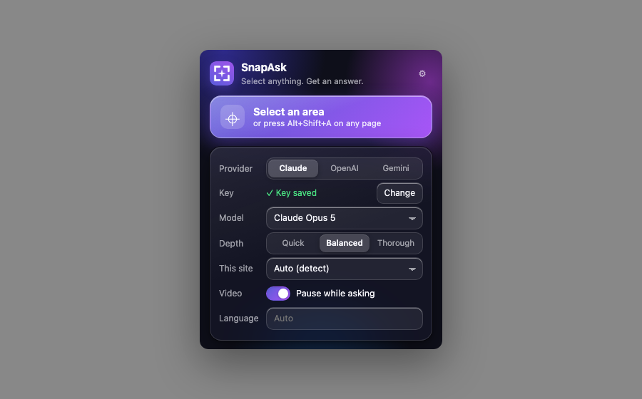
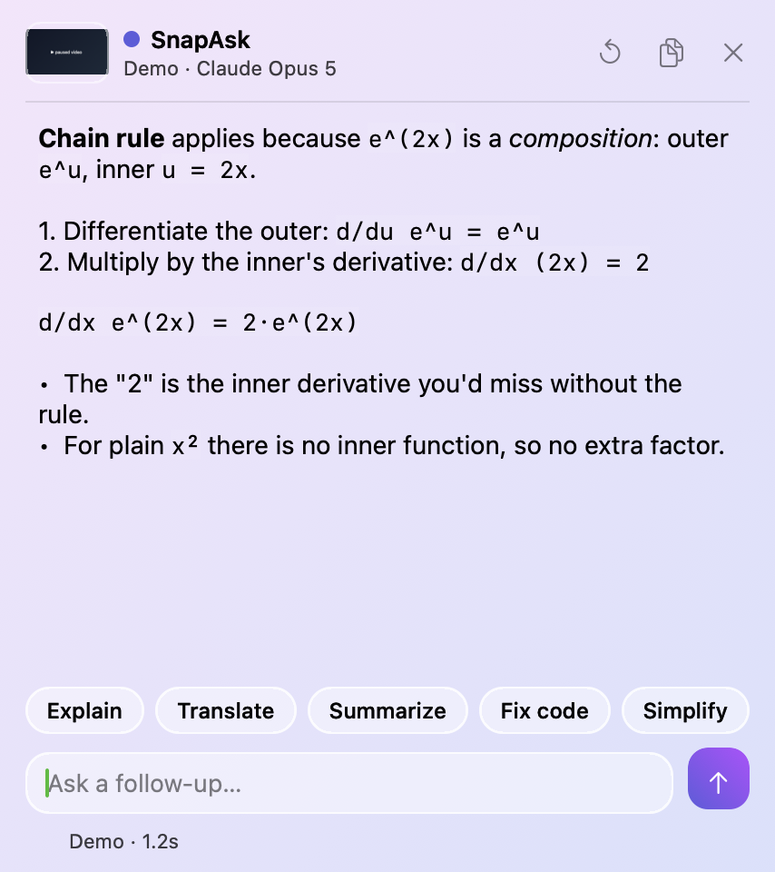
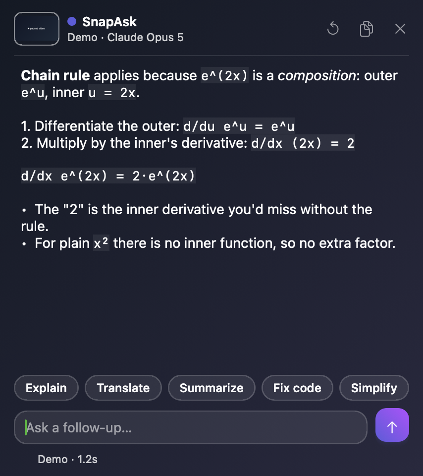
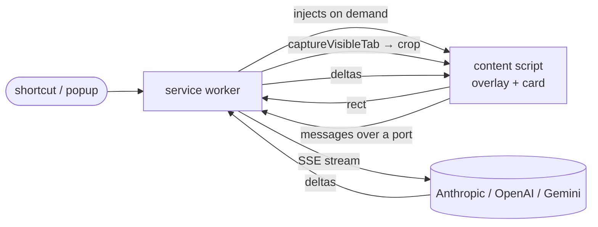

# SnapAsk

**Select anything on screen. Get an answer beside it. Nothing else.**

[](https://github.com/rupeshreddy007/snapask/actions)   

A Chrome extension and a macOS menu-bar app that turn "I don't get this part of the video / page / code" into one gesture: press a shortcut, drag a box, read the streamed answer in a floating card next to the thing you selected. Follow up in the same card. Your own API key or Claude login, no server, nothing stored.

<p align="center">
  
</p>

## The problem it replaces

Every time I was unsure about something in a lecture video or a doc, the routine was: screenshot → find the file → copy → switch to the ChatGPT tab → paste → type the question → wait → switch back → delete the image. Seven steps, two app switches, and a screenshots folder full of junk.

SnapAsk: `Alt+Shift+A` → drag → read. Two seconds, no tab switch, no file.

## What it does

| | |
|---|---|
| **One gesture** | Shortcut or toolbar button, drag a region, answer streams in beside it. Enter grabs the whole screen, Esc cancels. |
| **Text without screenshots** | Highlight text first and the extension sends the text, not pixels: faster, cheaper, sharper. |
| **Knows what you're looking at** | A playing video gets a lecture-style explanation, GitHub or a code selection gets *Code*, a page in another language gets *Translate*. Override per site from the popup. |
| **Stays out of the way** | Pauses the video while the card is open and resumes it when you close. Floats over full-screen players. |
| **Keeps the thread** | Follow-ups keep the image in context. Chips re-ask the same selection as Explain / Translate / Summarize / Code / Simplify. |
| **Your account, your data** | Anthropic, OpenAI or Gemini key, stored locally. Or hand the question off to your own ChatGPT or Claude account with one click. |
| **Minimal permissions** | `activeTab`, `scripting`, `storage`. No "read all your data on all websites" prompt; the content script is injected only when you trigger it. |

<p align="center">
  
  
</p>

## Two apps, one idea

| | Chrome extension (`extension/`) | macOS app (`macos/`) |
|---|---|---|
| Captures | The visible tab, cropped in memory | Any region of any screen via the system selector |
| Backend | Anthropic / OpenAI / Gemini, bring your own key | Claude Code CLI (your Claude login, no key) or the Claude API |
| UI | Shadow-DOM glass card in the page | Liquid Glass panel (`NSGlassEffectView`) |
| Extras | Text mode, per-site modes, video auto-pause, ChatGPT/Claude hand-off | Media pause via the play/pause key, open at login, glass settings window |
| Lines | ~1,900 JS (no dependencies) | ~1,400 Swift (no dependencies) |

<p align="center">
  
  
</p>

## Quick start

**Extension**

1. `chrome://extensions` → Developer mode → Load unpacked → choose `extension/`.
2. The setup page opens. Pick a provider, paste a key, click **Connect**.
3. On any page: `Alt+Shift+A` (Option+Shift+A on Mac), drag.

**macOS app**

```bash
cd macos && ./build.sh && open build/SnapAsk.app
```

Press `⌘⇧A`. Grant Screen Recording when asked. Works out of the box if the `claude` CLI is installed and logged in; otherwise add a key in Settings.

## How it works



The service worker never sees the page; the content script never sees the API key. Everything that can be a pure function lives in `extension/lib/` and is unit-tested in Node without a browser. Full walk-through: [docs/ARCHITECTURE.md](docs/ARCHITECTURE.md). Why it is built this way: [docs/DECISIONS.md](docs/DECISIONS.md).

## Privacy

- The screenshot is cropped in memory and sent only to the provider you chose, over HTTPS. There is no SnapAsk server, no analytics, no history.
- Keys live in `chrome.storage.local` (not synced) or `~/.config/snapask/config.json` (mode 600).
- Model output is HTML-escaped before the lightweight markdown renderer touches it.
- The ChatGPT/Claude buttons open the official sites with a prefilled prompt. SnapAsk never automates or scrapes them.

Policy text for the store: [docs/PRIVACY.md](docs/PRIVACY.md).

## Testing

```bash
npm test             # 13 unit tests: markdown safety, three SSE parsers, error mapping, mode detection, settings
npm run check        # manifest stays minimal and every referenced file exists
npm run harness      # drive the real content script in any browser with a fake chrome.* (test/harness.html)
npm run screenshots  # regenerate docs/images with headless Chrome
```

The harness runs the production `content.js` on a sample page with a fake `chrome.*`, a real `<video>`, and a scripted streaming provider, so overlay, crop maths, streaming, follow-ups, pause/resume and error states can be exercised without a key. CI runs the tests, the manifest check, packs the zip, and builds the Swift app.

## Project layout

```
extension/   Manifest V3 extension: background.js, content.js, popup, options, lib/, test/
macos/       Swift app: Sources/main.swift, build.sh, Info.plist
docs/        architecture, decisions, interview notes, privacy policy, store listing, images
scripts/     manifest check, screenshot generator
.github/     CI
```

## Roadmap

Voice follow-ups, re-ask-last-selection shortcut, quiz mode, Firefox build, optional local history, streaming in the macOS app, "Sign in with ChatGPT" for the macOS app (the open-source OAuth flow fits a desktop app; it does not fit an extension yet).

## License

MIT.
