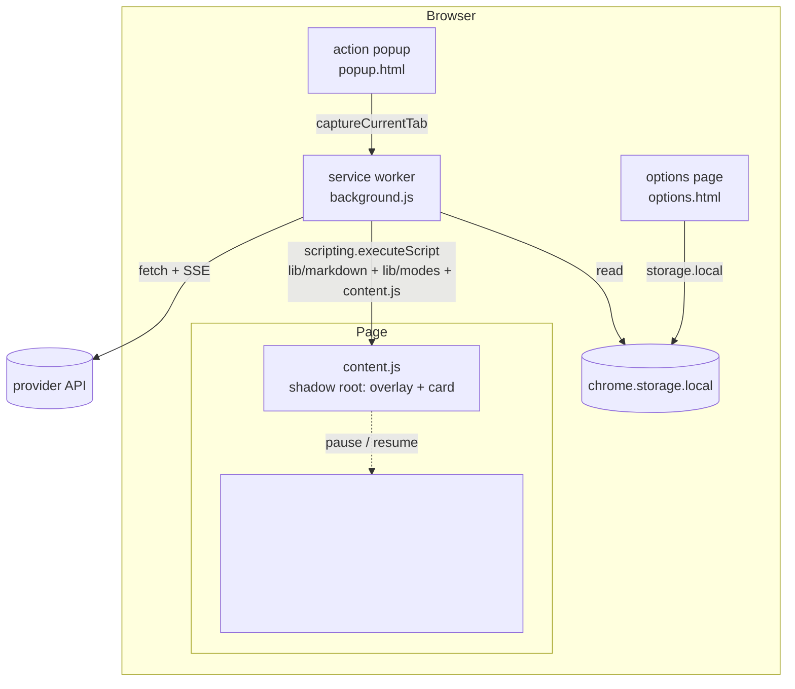

# Architecture

## Chrome extension

### Components



| Module | Responsibility | Tested by |
|---|---|---|
| `background.js` | Triggers (command, popup), on-demand injection, `captureVisibleTab`, crop, streaming over a port, key test | harness shim + manual |
| `content.js` | Selection overlay, text-selection path, answer card, follow-ups, chips, hand-off, video pause/resume | `test/harness.html` |
| `lib/providers.js` | Request builders and SSE extractors for Anthropic, OpenAI, Gemini; error humanising | unit tests with canned streams |
| `lib/modes.js` | Answer modes, page-signal detection, per-site override precedence | unit tests |
| `lib/settings.js` | Schema, defaults, merge, system prompt, the key-free "public view" | unit tests |
| `lib/markdown.js` | Escape-first markdown renderer, tolerant of unterminated fences while streaming | unit tests |
| `lib/crop.js` | OffscreenCanvas crop; scale derived from bitmap vs viewport | harness |

### Capture sequence

```mermaid
sequenceDiagram
    actor U as User
    participant SW as service worker
    participant CS as content script
    participant P as provider
    U->>SW: Alt+Shift+A (activeTab granted)
    SW->>CS: ping; inject if absent; start(publicSettings)
    alt text selected on the page
        CS->>CS: read selection, resolve mode, pause video
    else
        CS->>U: overlay (dim, crosshair, hint)
        U->>CS: drag rect
        CS->>CS: remove overlay, wait a frame or 150 ms
        CS->>SW: capture {rect, viewport}
        SW->>SW: captureVisibleTab → crop (OffscreenCanvas)
        SW-->>CS: {image}
    end
    CS->>CS: open card beside rect
    CS->>SW: port "ask" {messages}
    SW->>P: POST /messages (stream)
    P-->>SW: SSE deltas
    SW-->>CS: delta, delta, ..., done
    CS->>CS: render markdown (throttled 40 ms)
    U->>CS: follow-up / chip / Esc
    CS->>CS: on close: resume video, disconnect port
```

### Data shapes

Neutral conversation format, owned by the content script:

```js
[{ role: 'user', text: '[Page: … — host]\n[My language: en-GB]\n[Selected text]…\n\nExplain …', image: { dataUrl, mediaType } },
 { role: 'assistant', text: '…' },
 { role: 'user', text: 'Is this O(2^n)?' }]
```

The image rides only on the first user message. Each provider adapter maps this to its own wire format. Switching providers mid-conversation therefore works.

Settings reach the content script through `publicView()`, which strips keys. The page can never read a key, even if the shadow root were inspected.

### Streaming

`background.js` opens one `chrome.runtime.Port` per question. The worker fetches with `stream: true`, parses `text/event-stream` with a small generator (`sseEvents`), and posts `{type:'delta'}` messages. Closing the card disconnects the port, which aborts the fetch through an `AbortController`. A new question while streaming disconnects and finalises the previous answer first.

### Mode resolution

`resolve(settings, signals)` precedence: per-site override (hostname or parent domain) → user default mode → detection. Detection signals are read **before** the video is paused, because "a video is playing" is the main signal for lecture mode.

## macOS app

Single Swift file, AppKit, no dependencies.

```mermaid
flowchart LR
    HK[Carbon hotkey ⌘⇧A] --> AD[AppDelegate]
    AD --> MC[MediaControl<br/>CoreAudio check → play/pause key]
    AD --> SC[/usr/sbin/screencapture -i]
    SC -- PNG in memory, file deleted --> BE
    BE{backend} --> CLI[claude -p --output-format json<br/>stable cwd, --resume]
    BE --> API[Claude API via URLSession]
    BE --> PN[AnswerPanel<br/>NSGlassEffectView]
    AD --> SW[SettingsWindow] -- config.json --> AD
```

- **Backends** share a protocol (`ask(image:question:)`, `reset()`); the CLI backend keeps a session id for follow-ups and deletes the previous transcript from `~/.claude/projects` when a new conversation starts.
- **Panel** is a borderless, non-activating floating panel that joins all Spaces (so it shows over full-screen video), with the glass view as its content view.
- **Media pause** checks `kAudioDevicePropertyDeviceIsRunningSomewhere` before synthesising `NX_KEYTYPE_PLAY`; on close it only presses again if still silent.
- **Demo mode** (`--demo [settings] [dark] --snapshot out.png`) renders layouts offscreen for docs and layout checks.

## Testing strategy

| Layer | How |
|---|---|
| Pure logic (`lib/`) | `node --test`, no browser, canned SSE streams, XSS probes |
| UI (`content.js`, popup, options) | `test/*.html` harnesses with a fake `chrome.*`; drive with a real browser or headless Chrome |
| Packaging | `scripts/check-manifest.js` fails on permission creep or missing files |
| Swift | builds in CI on macOS 26; `--test image.png` runs a real backend round trip locally |

What is **not** automated: real calls to the provider APIs (need keys) and the glass material on screen (composited by the window server).
